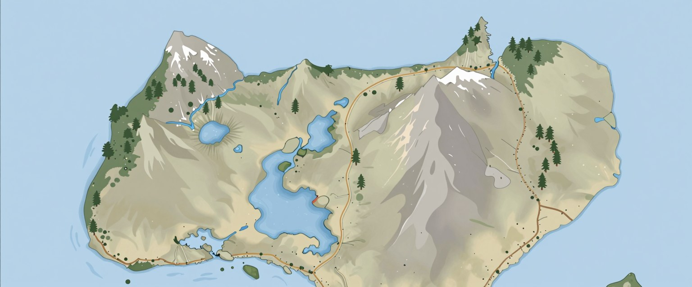

# mapwright



An agent plugin for maps of real places, fantasy worlds and science fiction settings. It reads, writes, finds and generates maps, and checks its own numbers against published values.

mapwright is a skill for AI coding agents plus one small script, `mpw.py`, that needs nothing but Python's standard library.

## What works in 0.10.0

- **Inspect** a map file: GeoJSON, GPX, KML and KMZ, shapefiles, dBASE, PNG heightmaps with world files, GeoPackage and MBTiles. Feature counts, extent, properties and the CRS when the file states one.
- **Convert** between GeoJSON, GPX and KML, and read shapefiles into GeoJSON. Ring order is fixed on the way (shapefiles clockwise, GeoJSON counter-clockwise).
- **Measure** geodesic distance and bearing on the WGS84, GRS80 or Clarke 1866 ellipsoid, polygon area on the ellipsoid, and map scale conversions.
- **Project** points forward and back: Web Mercator, equirectangular, Mollweide, Lambert azimuthal equal-area, Robinson and Equal Earth.
- **Explain** projections, symbols and methods in plain words.
- **Generate** invented worlds: plates, erosion, rivers, lakes, climate and biomes; settlements ranked city, town and village; roads by least-cost paths; place names from a sound pattern. Child maps (zoom) keep the parent's coast, rivers, settlements, roads and names. `check` runs 16 proof bars on a world.

- **Render** a recipe folder to SVG, PNG or PDF in six looks (topographic, atlas, satellite, ink-and-parchment, blueprint, star-chart) with labels that never overlap, a legend of what is on the map, a scale bar and a north arrow; serve it as a pan and zoom page on 127.0.0.1; set styles or seeds side by side on one sheet.

- **Read** a map picture (0.3.0): size, colour classes, dominant colours, text when tesseract is installed and "not sure" when it is not; a georeference only from control points you give, with residuals and a world file; a checklist for an agent's own vision whose answers the script then checks.
- **Trace** a map picture to GeoJSON: water or any colour to polygons with holes, or thin features to centre lines, simplified, in pixels or georeferenced. A rendered world traced back lands within 0.3 px (median) of its own coastline.

- **Find** maps and data for a place, a time or a subject (0.4.0): a catalogue of open sources with the licence and credit line for each, plus optional live lookups (Nominatim, Wikimedia Commons, Library of Congress, OpenTopography with your own key).
- **Fetch** one file politely: a plain mapwright User-Agent, each source's rate kept across runs, a disk cache, and `sources.json` plus `CREDITS.txt` written beside the data. The never-scrape list (Google, Bing, Mapbox, OSM tiles and the rest) and bulk sets over a size cap are refused.

- **Cities, dungeons and battle maps** (0.5.0): `gen city` (streets, blocks, lots, wall and gates, districts, optionally sited on a world's settlement), `gen dungeon` (BSP rooms or caves, doors, lights), `gen battle` (square or hex grid, pixels per square), checked by reachability, whole-pixel grid and byte-identical regeneration bars, and `export` to Universal VTT (.dd2vtt) for Foundry and other tabletops.
- **Dungeons** (0.9.0): `gen dungeon --method cyclic` builds a lock-and-key dungeon graph first (two paths from start to goal, nested cycles, one-way doors) and raises it to rooms and corridors; every dungeon gets a goal at its far end; cave parameters are flags; `check --range` measures a generator's expressive range over 500 seeds and draws the heatmap. `fetch` records the licence of each geoBoundaries file from the API answer instead of assuming CC BY 4.0.

- **Drainage and battle layout** (0.12.0): zoom windows with no sea drain through the edge where the parent's rivers leave, the rain-shadow bar skips arid windward sides, battle maps put the title and legend outside the grid, treasure always sits inside its room, and `legend` works on battle maps.
- **Paths, density and branches** (0.11.0): `path` on a cyclic dungeon fetches each key before its lock (`--ignore-locks` for the old search), `path --jps` runs jump point search on square grids, `export --nav` writes walkable rectangles and portals as JSON, `gen battle --density sparse|normal|dense` with a legend of what is on the map, and `gen dungeon --method cyclic --branches N` adds dead ends with treasure and secret doors.

- **Space** (0.6.0): `gen sector` (hex subsector or sector, worlds, connected jump routes, a T5 tab-delimited file; `--real` for twelve near stars placed by parallax), `gen system` (star, planets on stable orbits, moons, schematic and to-scale diagrams), `gen planet` (rocky, ice, ocean, gas giant, cratered moon or tidally locked sphere textures with no seam and no pole pinch), `gen deck` (ship or station deck plans, every room reachable from the airlock). `check` proves the route graph connected, star distances, orbit spacing, the seam and poles, and deck reachability; `export` writes a planet as a sphere PNG with a hand-off note for three.js and Blender.

- **Export** (0.7.0) to the tools that take a map further, each file read back and checked before it is reported:
  - engine heightmaps from a world or region: Unity RAW (16 bit, 2^n + 1), Unreal 16-bit PNG at landscape sizes, R16 or 16-bit PNG for Godot, a Roblox heightmap with a colormap of material colours, and a sidecar with metres per pixel, the height range and the import settings;
  - Tiled maps (.tmj) of dungeons, square battle maps and deck plans with a generated tileset, walls and doors as object layers and an optional CSV;
  - deck plans to Universal VTT and hex battle maps to PNG;
  - a terrain mesh (OBJ) with optional vertical exaggeration and a base that makes it a watertight print tile, plus a manifest in polywright's asset format;
  - print-ready PDF and PNG at A4, A3, Letter, Tabloid or a custom size, at a chosen DPI, with bleed and crop marks, through headless Chrome or Edge.

- **AI style pass** (0.8.0, optional): `aistyle` repaints a world or region map on your own ComfyUI server in four looks (painted atlas, ink and parchment, satellite, watercolour) and keeps the geography. The model gets the map without text; lakes, rivers, roads, symbols, labels, the legend, the scale bar and the north arrow are set in code on top. Each picture is measured against the map's own coast and gets a sidecar with the model, its licence class, the prompt, the seed and the numbers. Measured on 72 pictures: every one kept the coast at denoise 0.45 or below, none at 0.65. `--dry-run` works with no server.

- **Pathfinding** (0.10.0): `path` finds the cheapest route on dungeons, battle maps (square and hex), deck plans, worlds and regions and draws it on the map; `path --field` gives every cell its cost to the nearest goal and its next step, a flow field for many units; `travel` turns a world or region into walking hours by Tobler's hiking function; `check --chokepoints` lists the cells whose loss splits a map and the smallest cut from entrance to goal; `check --fair` compares starting points by their distance to resources and the ground each reaches first. Every A* cost equals plain Dijkstra on the test maps.

Labels on curves come next.

## Use

```
python scripts/mpw.py doctor
python scripts/mpw.py inspect hike.gpx
python scripts/mpw.py convert hike.gpx hike.geojson
python scripts/mpw.py measure distance -41.32 174.81 40.96 -5.50
python scripts/mpw.py project mollweide 100 45
python scripts/mpw.py explain web-mercator
python scripts/mpw.py gen world --seed 7 --style nordic --out isles.map
python scripts/mpw.py zoom isles.map --out isles-south.map
python scripts/mpw.py check isles-south.map
python scripts/mpw.py names --sample 10 --style desert
python scripts/mpw.py names --list
python scripts/mpw.py render isles.map -o isles.png --style ink-and-parchment
python scripts/mpw.py label isles.map
python scripts/mpw.py legend isles.map --style atlas
python scripts/mpw.py style --list
python scripts/mpw.py serve isles.map
python scripts/mpw.py sheet isles.map --styles atlas,blueprint,star-chart -o pick.png
python scripts/mpw.py export isles.map -o isles.raw --size 1025
python scripts/mpw.py export isles.map -o tile.obj --print-mm 100 --exaggeration 20
python scripts/mpw.py export crypt.map -o crypt.tmj --csv
python scripts/mpw.py export ship.map -o ship.dd2vtt
python scripts/mpw.py export isles.map --to print -o poster --paper A3 --bleed 3
python scripts/mpw.py aistyle isles.map --look watercolour --dry-run
python scripts/mpw.py gen dungeon --seed 4 --out crypt
python scripts/mpw.py path crypt --from 42,29 --to 24,34
python scripts/mpw.py check crypt --chokepoints --fair
python scripts/mpw.py aistyle isles.map --look painted-atlas --host http://127.0.0.1:8188
```

## Tests

`python -m unittest discover -s tests`. Distances match Geoscience Australia's Vincenty example and GeographicLib's documented values to a millimetre. The tests need no GPU and no network; `tests/aistyle_grid.py` is the harness that measured the style pass on a real server.

## Licence

MIT. See [LICENSE](LICENSE). Security reports: [SECURITY.md](SECURITY.md).
